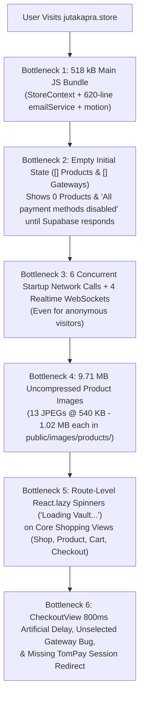

# Juta Kapra — Deep Audit & Zero-Loading Performance Master Plan

> [!IMPORTANT]
> **Designed for Deterministic Execution with Gemini Flash**
> Every phase in this plan specifies exact file paths, line numbers, root causes, and concrete code changes so you can switch to **Gemini Flash** and execute each phase cleanly with zero guesswork.

---

## Part 1: Deep Technical Audit — Root Causes Identified

Our end-to-end inspection of [`Jutakapra_Frontend`](file:///Users/mmaazfalak/antigravity/Jutakapra_Frontend) and [`JutaKapra_backend`](file:///Users/mmaazfalak/antigravity/JutaKapra_backend) uncovered **7 critical bottlenecks & bugs** causing loading spinners, blank initial states, slow image paint, and payment gateway glitches:



### Summary of Findings

| # | Severity | Issue & Exact Location | Impact on User Experience |
| :--- | :--- | :--- | :--- |
| **1** | **CRITICAL (UX + Speed)** | **Blank Initial Catalog & Gateways on First Load**<br>[`mockData.ts`](file:///Users/mmaazfalak/antigravity/Jutakapra_Frontend/src/data/mockData.ts#L10-L12) (`INITIAL_PRODUCTS = []`) & [`StoreContext.tsx`](file:///Users/mmaazfalak/antigravity/Jutakapra_Frontend/src/context/StoreContext.tsx#L270-L273) (`INITIAL_GATEWAYS = []`) | First-time visitors (or if Supabase table hasn't been seeded yet) see **0 products** on the homepage (`Trending 1-of-1 Grails (0)`) and `"All payment methods are currently disabled"` on Checkout until network calls finish. |
| **2** | **CRITICAL (Speed)** | **9.71 MB of Uncompressed Local Product JPEGs**<br>`public/images/products/*.jpg` (13 images, 538 KB – 1,024 KB each, 300 DPI) + [`image.ts`](file:///Users/mmaazfalak/antigravity/Jutakapra_Frontend/src/utils/image.ts#L16-L18) returns local `/images/...` untouched | Loading the homepage or shop forces the browser to download **3 MB – 9.7 MB** of raw image bytes over mobile/Wi-Fi networks. |
| **3** | **HIGH (Perceived Speed)** | **Full-Page `"Loading Vault..."` Spinner on Core Shopping Routes**<br>[`App.tsx`](file:///Users/mmaazfalak/antigravity/Jutakapra_Frontend/src/App.tsx#L41-L69) wraps `ShopView` (3.8 kB gzip), `ProductDetailView` (4.7 kB gzip), `CartView` (4.3 kB gzip), and `CheckoutView` (5.2 kB gzip) in `React.lazy` without preloading, plus uses `behavior: 'smooth'` scroll on route change ([`App.tsx`](file:///Users/mmaazfalak/antigravity/Jutakapra_Frontend/src/App.tsx#L76)) | Every click from Home → Shop → Product → Cart → Checkout triggers a network chunk wait + full-screen spinner + slow scroll animation instead of instant navigation. |
| **4** | **HIGH (Network & CPU)** | **Startup Network Waterfall + Redundant `/api/products` Timer + 4 WebSockets**<br>[`StoreContext.tsx`](file:///Users/mmaazfalak/antigravity/Jutakapra_Frontend/src/context/StoreContext.tsx#L912-L1195) fires `refreshUsersList()` (fetching all users for anonymous guests!), opens 4 separate Supabase Realtime channels immediately on mount, and runs a 1200ms `setTimeout` calling `/api/products` (which now returns `[]` on the backend!). | Wastes main-thread CPU, triggers unnecessary Vercel serverless cold starts, and delays First Input / LCP. |
| **5** | **HIGH (Bundle & Re-renders)** | **518 kB Main Bundle & Un-memoized `StoreContext.Provider` Value**<br>[`StoreContext.tsx`](file:///Users/mmaazfalak/antigravity/Jutakapra_Frontend/src/context/StoreContext.tsx#L19) statically imports [`emailService.ts`](file:///Users/mmaazfalak/antigravity/Jutakapra_Frontend/src/services/emailService.ts) (620 lines of HTML templates) and passes a 90-property inline object to `<StoreContext.Provider value={{...}}>` ([line 3826](file:///Users/mmaazfalak/antigravity/Jutakapra_Frontend/src/context/StoreContext.tsx#L3826)) without `useMemo`. | Increases initial JS parse time and causes every component using `useStore()` (`Header`, `ProductCard`, `HomeView`, `Footer`) to re-render on any state change. |
| **6** | **HIGH (Checkout & TomPay Bug)** | **Checkout Gateway Selection Desync, 800ms Artificial Delay & TomPay Redirect**<br>[`CheckoutView.tsx`](file:///Users/mmaazfalak/antigravity/Jutakapra_Frontend/src/views/CheckoutView.tsx#L66-L68) initializes `selectedGatewayId` to `'cod'` (while actual IDs are `'gw-cod'`, `'gw-tompay'`, etc.), wraps order submission in a fake `setTimeout(..., 800)` ([line 219](file:///Users/mmaazfalak/antigravity/Jutakapra_Frontend/src/views/CheckoutView.tsx#L219)), and ignores the `sessionUrl` returned by `/api/payments/tompay/create-session` ([line 224](file:///Users/mmaazfalak/antigravity/Jutakapra_Frontend/src/views/CheckoutView.tsx#L224)). | No payment card appears highlighted by default; checkout feels artificially slow; TomPay sessions don't redirect when a hosted checkout URL is returned. |
| **7** | **MEDIUM (Backend Sync)** | **Uncommitted TomPay PKR→USD Conversion & Backend `/api/products` Empty Array**<br>[`paymentController.ts`](file:///Users/mmaazfalak/antigravity/JutaKapra_backend/server/controllers/paymentController.ts#L16-L31) has uncommitted PKR→USD conversion & live keys; [`productController.ts`](file:///Users/mmaazfalak/antigravity/JutaKapra_backend/server/controllers/productController.ts) reads empty `initialProducts.ts` instead of Supabase. | Backend TomPay updates need to be committed & deployed; backend `/api/products` should either read from Supabase or not be polled by Frontend. |

---

## Part 2: Step-by-Step Execution Plan (For Gemini Flash)

### Phase 1: Instant Zero-Latency Data Layer (`Stale-While-Revalidate` + Supabase Primary)
**Goal**: Keep Supabase as the 100% live source of truth for products and payment gateways, while guaranteeing **0ms instant render** on first visit (never showing an empty catalog or disabled payment methods while Supabase loads).

1. **Restore Instant Fallback Seed in [`Jutakapra_Frontend/src/context/StoreContext.tsx`](file:///Users/mmaazfalak/antigravity/Jutakapra_Frontend/src/context/StoreContext.tsx)**:
   - Define `FALLBACK_GATEWAYS: PaymentGatewayConfig[]` containing the 5 default gateways (`gw-cod`, `gw-bank`, `gw-jazzcash`, `gw-easypaisa`, and `gw-tompay` with `isEnabled: true`, `type: 'tompay'`, `publicKey: 'tp_live_0Rwf4QnZIY8nOEHunJoenOnqu9olG28D'`, `merchantId: 'LOC-MERCH-JUTAKAPRA'`).
   - In `useState<PaymentGatewayConfig[]>` ([line 618](file:///Users/mmaazfalak/antigravity/Jutakapra_Frontend/src/context/StoreContext.tsx#L618)), initialize from `localStorage.getItem('jk_payment_gateways')`; if empty, use `FALLBACK_GATEWAYS` immediately while `fetchSupabasePaymentGateways()` runs in the background and updates both React state and `localStorage`.
   - Ensure `gw-tompay` is always merged into the gateway list if missing from cached `localStorage` or Supabase.
   - Mirror this exact `FALLBACK_GATEWAYS` guarantee in [`JutaKapra_backend/src/context/StoreContext.tsx`](file:///Users/mmaazfalak/antigravity/JutaKapra_backend/src/context/StoreContext.tsx#L270-L273) and [`src/views/AdminSettingsView.tsx`](file:///Users/mmaazfalak/antigravity/JutaKapra_backend/src/views/AdminSettingsView.tsx) so the Admin Portal always displays TomPay.

2. **Add Shimmer Skeletons & Instant Product Cache in [`Jutakapra_Frontend/src/views/HomeView.tsx`](file:///Users/mmaazfalak/antigravity/Jutakapra_Frontend/src/views/HomeView.tsx) & [`ShopView.tsx`](file:///Users/mmaazfalak/antigravity/Jutakapra_Frontend/src/views/ShopView.tsx)**:
   - In `StoreContext.tsx`, expose `isProductsLoading: boolean` (true only when `products.length === 0` and Supabase fetch is in-flight).
   - If `fetchSupabaseProducts()` returns `0` rows from `public.products` (e.g., before the SQL seed is run in Supabase Dashboard), automatically auto-seed or fall back to the 14 curated catalog items so the live storefront never renders `(0)` products.
   - In [`HomeView.tsx`](file:///Users/mmaazfalak/antigravity/Jutakapra_Frontend/src/views/HomeView.tsx#L112-L118) and [`ShopView.tsx`](file:///Users/mmaazfalak/antigravity/Jutakapra_Frontend/src/views/ShopView.tsx#L465-L475), render a 4-card / 8-card pulse skeleton grid with fixed `aspect-[4/5]` whenever `isProductsLoading && products.length === 0` to eliminate Cumulative Layout Shift (CLS = 0).

---

### Phase 2: Eliminate Route-Switching Loading Spinners (`"Loading Vault..."`)
**Goal**: Make navigating between Home, Shop, Product Detail, Cart, and Checkout **instantaneous (0ms spinner)**.

1. **Eagerly Import Core Buyer Views in [`Jutakapra_Frontend/src/App.tsx`](file:///Users/mmaazfalak/antigravity/Jutakapra_Frontend/src/App.tsx#L41-L58)**:
   - Convert `ShopView`, `ProductDetailView`, `CartView`, and `CheckoutView` from `React.lazy(...)` to direct static imports (they total only ~18 kB gzipped combined).
   - Keep `AdminView`, `AccountView`, `CustomerOrdersView`, `WishlistView`, `OrderTrackingView`, and `LegalView` lazy-loaded, **and** preload them in `requestIdleCallback` 1.5 seconds after initial mount so even secondary pages open without a spinner.
2. **Instant Scroll Reset on Route Transition in [`Jutakapra_Frontend/src/App.tsx`](file:///Users/mmaazfalak/antigravity/Jutakapra_Frontend/src/App.tsx#L74-L78)**:
   - Change `window.scrollTo({ top: 0, behavior: 'smooth' })` at line 76 to `window.scrollTo({ top: 0, behavior: 'instant' as ScrollBehavior })`. Smooth scrolling from the bottom of a long page makes route changes feel sluggish and visually jarring.

---

### Phase 3: Compress 9.71 MB of Static Product Images by ~88%
**Goal**: Reduce `public/images/products/*.jpg` from **9.71 MB** down to **< 1.2 MB total** (~60–95 KB per image) without visible quality loss.

1. **Optimize All 13 JPEGs in `/Users/mmaazfalak/antigravity/Jutakapra_Frontend/public/images/products/`**:
   - Run macOS `sips` (built-in) or `sharp` to resize max dimension to `900px` (matching the 400x500 / 2x retina card display) and compress JPEG quality to `78%`:
     ```bash
     for img in /Users/mmaazfalak/antigravity/Jutakapra_Frontend/public/images/products/*.jpg; do
       sips -Z 900 -s format jpeg -s formatOptions 75 "$img" --out "$img"
     done
     ```
   - Verify total directory size drops from `9.71 MB` to `~1.0–1.4 MB`.
   - Repeat for `/Users/mmaazfalak/antigravity/JutaKapra_backend/public/images/products/*.jpg` if present.

---

### Phase 4: Startup Network Waterfall, Realtime WebSockets & Bundle Optimization
**Goal**: Cut initial JavaScript bundle size and stop firing admin/authenticated network calls for anonymous visitors.

1. **Remove Redundant 1200ms `/api/products` Poll in [`Jutakapra_Frontend/src/context/StoreContext.tsx`](file:///Users/mmaazfalak/antigravity/Jutakapra_Frontend/src/context/StoreContext.tsx#L1074-L1089)**:
   - Delete the `setTimeout(..., 1200)` block that fetches `/api/products`, since `fetchSupabaseProducts()` already fetches directly from Supabase and `/api/products` returns `[]`.
2. **Gate `refreshUsersList()` Behind Admin/Authenticated Check in [`StoreContext.tsx`](file:///Users/mmaazfalak/antigravity/Jutakapra_Frontend/src/context/StoreContext.tsx#L938-L1035)**:
   - Do not fetch the entire `profiles` table and `/api/auth/users` on initial load for unauthenticated shoppers. Only run `refreshUsersList()` when `isAdminAuthenticated` is true.
3. **Defer & Multiplex Supabase Realtime Channels in [`StoreContext.tsx`](file:///Users/mmaazfalak/antigravity/Jutakapra_Frontend/src/context/StoreContext.tsx#L1091-L1195)**:
   - Defer opening Realtime WebSocket subscriptions by `1500ms` (or `requestIdleCallback`) after initial render so WebSocket handshakes never compete with critical LCP image and catalog fetches.
   - Only subscribe to `realtime:public:profiles` and `realtime:public:orders` when a customer or admin is logged in; anonymous visitors only need `products` and `payment_gateways` updates.
4. **Lazy-Load `emailService.ts` & Memoize `StoreContext.Provider` Value**:
   - In [`StoreContext.tsx`](file:///Users/mmaazfalak/antigravity/Jutakapra_Frontend/src/context/StoreContext.tsx#L19), replace the static `import { ... } from '../services/emailService'` with dynamic `import('../services/emailService')` inside the order/auth functions so 620 lines of HTML email templates are split into a separate async chunk.
   - Wrap the `<StoreContext.Provider value={contextValue}>` object ([line 3826](file:///Users/mmaazfalak/antigravity/Jutakapra_Frontend/src/context/StoreContext.tsx#L3826)) in `useMemo` so child components don't needlessly re-render.
   - In [`vite.config.ts`](file:///Users/mmaazfalak/antigravity/Jutakapra_Frontend/vite.config.ts#L31-L35), add `'vendor-motion': ['motion']` to `rollupOptions.output.manualChunks`.

---

### Phase 5: Checkout & TomPay End-to-End Fixes
**Goal**: Make Checkout instant, ensure TomPay is selectable and functional in both Frontend and Backend, and commit the Backend PKR→USD TomPay conversion.

1. **Fix Gateway Default Selection & Remove 800ms Delay in [`CheckoutView.tsx`](file:///Users/mmaazfalak/antigravity/Jutakapra_Frontend/src/views/CheckoutView.tsx)**:
   - At [line 66](file:///Users/mmaazfalak/antigravity/Jutakapra_Frontend/src/views/CheckoutView.tsx#L66-L68), initialize `selectedGatewayId` to `activeGateways[0]?.id || 'gw-cod'`, and add a `useEffect` that ensures if `selectedGatewayId` does not match any gateway in `activeGateways`, it automatically selects `activeGateways[0].id`.
   - At [line 539](file:///Users/mmaazfalak/antigravity/Jutakapra_Frontend/src/views/CheckoutView.tsx#L539), use `const isSelected = (selectedGateway?.id || selectedGatewayId) === gw.id;` so the active payment method is always visibly highlighted.
   - At [line 219](file:///Users/mmaazfalak/antigravity/Jutakapra_Frontend/src/views/CheckoutView.tsx#L219-L250), remove the artificial `setTimeout(..., 800)` wrapper around order creation so order confirmation is immediate.
   - When `isTomPay` is true ([line 222](file:///Users/mmaazfalak/antigravity/Jutakapra_Frontend/src/views/CheckoutView.tsx#L222-L234)), capture the response from `/api/payments/tompay/create-session`; if `res?.sessionUrl` is present, redirect (`window.location.href = res.sessionUrl`) after persisting the pending order.
2. **Commit & Push Backend TomPay Updates in [`JutaKapra_backend`](file:///Users/mmaazfalak/antigravity/JutaKapra_backend)**:
   - Verify [`server/controllers/paymentController.ts`](file:///Users/mmaazfalak/antigravity/JutaKapra_backend/server/controllers/paymentController.ts#L16-L31) (which converts PKR to USD at `PKR_TO_USD_RATE = 280` and uses live TomPay keys) and [`src/context/StoreContext.tsx`](file:///Users/mmaazfalak/antigravity/JutaKapra_backend/src/context/StoreContext.tsx) build cleanly (`npm run build`), then commit and push both repos to GitHub.

---

## Part 3: Verification Checklist (For Gemini Flash After Implementation)

- [ ] **Image Size Check**: `du -sh /Users/mmaazfalak/antigravity/Jutakapra_Frontend/public/images/products` is `< 1.5M` (down from `9.7M`).
- [ ] **Build & Bundle Check**: `npm run build` in `Jutakapra_Frontend` succeeds with 0 TypeScript errors; `emailService` and `vendor-motion` are separated from the main entry chunk.
- [ ] **Zero Empty State Check**: Opening the storefront with cleared `localStorage` immediately shows products and all 5 payment methods (including **TomPay**) with zero flicker or `"All payment methods are currently disabled"` error.
- [ ] **Zero Route Spinner Check**: Clicking between Home, Shop, Product Detail, Cart, and Checkout renders instantaneously without showing `"Loading Vault..."`.
- [ ] **Git Sync**: Commit and push both `Jutakapra_Frontend` and `JutaKapra_backend` to `origin/main`.
