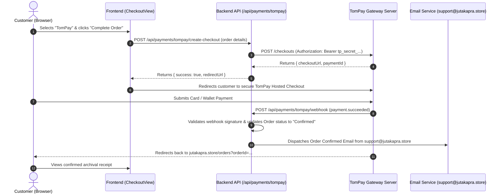

# Development Plan & Technical Specification

**Project**: Juta Kapra E-Commerce Platform  
**Storefront URL**: [https://www.jutakapra.store](https://www.jutakapra.store)  
**Backend API**: [https://jutakaprabackend.vercel.app](https://jutakaprabackend.vercel.app)  
**Date**: November 2026  

---

## 1. Executive Summary

This plan outlines the architecture, implementation steps, and verification strategies for two critical user-facing enhancements:
1. **Transitioning the Shopping Bag / Cart from a slide-out drawer to a dedicated page view** that keeps the top navigation header and bottom mobile navigation dock visible and interactive at all times.
2. **Hardening the Google Authentication & Account Password Lifecycle**, ensuring that once a Google-authenticated user sets a password, the system permanently requires an **"Update Password"** flow (strictly validating their current password) rather than permitting new password creation or looping back to setup mode.

---

## 2. Feature 1: Dedicated Shopping Bag Page (`CartView`)

### 2.1 Problem Statement
Currently, tapping the bag button opens `CartDrawer.tsx`, an overlay drawer sliding from the right (`x: '100%'` to `x: 0`) with a dark backdrop (`fixed inset-0 z-50 bg-black/60`). This hides both the top `<Header />` and the bottom mobile dock `<MobileAppNavBar />`, creating a disjointed user journey where the user cannot smoothly navigate back to other tabs.

### 2.2 Objective & Requirements
- **No right-sliding overlay drawer**: Deprecate and remove `<CartDrawer />` from the main rendering loop in `App.tsx`.
- **Full Dedicated View**: Clicking the Bag icon navigates directly to `currentView === 'cart'` which renders `CartView.tsx`.
- **Top Navigation Preserved**: The sticky desktop and mobile `<Header />` remains fully visible with brand logo, search, and profile actions.
- **Bottom Navigation Preserved**: The mobile navigation dock `<MobileAppNavBar />` remains anchored at the bottom with the Shopping Bag tab highlighted via the active red indicator.
- **Consistent Desktop Behavior**: `FloatingCartButton.tsx` and desktop cart actions navigate directly to `/cart` and hide or adjust when already on `/cart`.
- **Add-to-Cart Flow**: Adding an item to the cart will navigate to `/cart` or display a compact confirmation toast without opening any full-screen sliding backdrop.

### 2.3 Implementation Details
1. **[`MobileAppNavBar.tsx`](file:///Users/mmaazfalak/antigravity/Jutakapra_Frontend/src/components/MobileAppNavBar.tsx)**:
   - Define `isCartActive = currentView === 'cart'`.
   - Update Bag button `onClick` from `setIsCartOpen(true)` to `navigateTo('cart')`.
   - Apply active styles (`text-white`, `stroke-[2.5px]`, red hairline layout indicator) when `isCartActive` is true.
2. **[`FloatingCartButton.tsx`](file:///Users/mmaazfalak/antigravity/Jutakapra_Frontend/src/components/FloatingCartButton.tsx)**:
   - Update `onClick` from `setIsCartOpen(true)` to `navigateTo('cart')`.
   - Hide the button when `currentView === 'cart'`.
3. **[`StoreContext.tsx`](file:///Users/mmaazfalak/antigravity/Jutakapra_Frontend/src/context/StoreContext.tsx)**:
   - In `addToCart`, replace `setIsCartOpen(true)` with `navigateTo('cart')` (or non-intrusive toast feedback).
4. **[`App.tsx`](file:///Users/mmaazfalak/antigravity/Jutakapra_Frontend/src/App.tsx)**:
   - Remove `{isCartOpen && <CartDrawer />}` so no slide drawer is rendered.

---

## 3. Feature 2: Google Auth & Password Lifecycle

### 3.1 Problem Statement
When a user logs in with Google OAuth:
1. They are prompted in account settings to "Set Account Password" so they can also log in with email and password on other devices.
2. However, after setting their password, `db.upsertGoogleUser` in MongoDB omitted `passwordHash` in the returned object, causing subsequent logins to report `hasPassword: false`.
3. In `AccountView.tsx`, the current password input was conditionally hidden specifically for Google users: `(currentCustomer.passwordHash && currentCustomer.authProvider !== 'google')`. Consequently, Google users were never prompted for their current password and were stuck in a re-create loop.
4. In `authController.ts`, the password verification check did not strictly require `currentPassword` if a password hash already existed on the record.

### 3.2 Target Authentication Flows & Scenarios

| Scenario # | User Flow | System Behavior & Validation |
|---|---|---|
| **Flow 1** | **Standard Email Signup** | User enters Name, Email, Password -> Account created with bcrypt hash -> `hasPassword: true`. |
| **Flow 2** | **First-Time Google Sign-In** | User logs in with Google -> Account created with `authProvider: 'google'` and `hasPassword: false`. Account settings display **"Set Account Password"** (fields: New Password, Confirm Password). |
| **Flow 3** | **Google User Sets Password** | User submits New Password -> API hashes password, persists to MongoDB and Supabase Auth, updates `hasPassword: true`, and returns new session token. UI immediately switches to **"Update Password"**. |
| **Flow 4** | **Google User Updates Existing Password** | User visits Settings -> System detects `hasExistingPassword === true`. Form displays **"Update Password"** (fields: Current Password, New Password, Confirm Password). Submitting verifies `currentPassword` against bcrypt hash; fails with HTTP 400 if incorrect or missing. |
| **Flow 5** | **Returning Google Sign-In (Password Already Set)** | User logs in via Google button -> `upsertGoogleUser` preserves existing `passwordHash`. Profile payload returns `hasPassword: true`. Settings view displays "Update Password" flow requiring current password. |
| **Flow 6** | **Dual Sign-In Capability** | User with a Google-linked account who has set a password can log in either via Google One-Tap OR via email + password on any browser/device. |
| **Flow 7** | **Password Reset / Forgot Password** | User requests password reset -> OTP sent to email via Google Apps Script Webhook -> User verifies OTP and sets new password -> Account password updated. |
| **Flow 8** | **Session Logout & Security Cleanup** | User clicks Logout -> Backend clears HTTP-only session cookie -> Client clears Supabase auth tokens, customer localStorage session, and resets active state. |

### 3.3 Implementation Details
1. **Backend [`server/controllers/authController.ts`](file:///Users/mmaazfalak/antigravity/JutaKapra_backend/server/controllers/authController.ts)**:
   - In `changePassword`, if `user.passwordHash` exists, strictly enforce:
     ```typescript
     if (!currentPassword) {
       res.status(400).json({ success: false, message: 'Current password is required to update your existing password.' });
       return;
     }
     const isMatch = await verifyPassword(currentPassword, user.passwordHash);
     if (!isMatch) {
       res.status(400).json({ success: false, message: 'Current password is incorrect.' });
       return;
     }
     ```
2. **Backend [`server/db.ts`](file:///Users/mmaazfalak/antigravity/JutaKapra_backend/server/db.ts)**:
   - In `upsertGoogleUser`, ensure the returned `UserRecord` explicitly includes:
     ```typescript
     passwordHash: userDoc.passwordHash || (userDoc as any).password || '',
     password: userDoc.password || userDoc.passwordHash || '',
     ```
   - In the in-memory and FileDB fallback paths, retain existing `passwordHash` and `password` properties.
3. **Frontend [`AccountView.tsx`](file:///Users/mmaazfalak/antigravity/Jutakapra_Frontend/src/views/AccountView.tsx)**:
   - Compute `hasExistingPassword` across all session indicators:
     ```typescript
     const hasExistingPassword = Boolean(
       currentCustomer.hasPassword ||
       currentCustomer.passwordHash ||
       profile?.has_password ||
       (profile as any)?.password_hash ||
       (typeof window !== 'undefined' && activeEmail && localStorage.getItem('has_password_' + activeEmail.toLowerCase()) === 'true')
     );
     ```
   - Dynamically render form header: `{hasExistingPassword ? 'Update Password' : 'Set Account Password'}`.
   - Conditionally render `Current Password` input whenever `hasExistingPassword` is true (for all accounts, including Google).
   - Require `currentPassword` in submission handler when `hasExistingPassword` is true.
   - On successful update/creation, set `hasPassword = true` and update `localStorage.setItem('has_password_' + email, 'true')`.
4. **Frontend [`StoreContext.tsx`](file:///Users/mmaazfalak/antigravity/Jutakapra_Frontend/src/context/StoreContext.tsx)**:
   - In `loginWithGoogleCredential`, pass `hasPassword` and `passwordHash` from `verifiedUser` to `loginWithGoogle`.
   - In `loginWithGoogle`, retain `hasExistingPassword` on the constructed customer record.

---

## 4. Feature 3: Complete Email Lifecycle, Backend & Admin Panel Overhaul

### 4.1 Problem Statement
Previously, the store triggered duplicate or triplicate confirmation emails for each order due to concurrent frontend calls to Google Apps Script and backend webhook/SMTP triggers. Additionally, the admin interface lacked controls to confirm pending orders and specify an estimated delivery date on dispatch, and there was no background recovery for abandoned carts.

### 4.2 Objective & Architecture
1. **Google Apps Script Backend (`Code.gs`)**:
   - Single dispatcher `doPost(e)` accepting explicit actions: `send_order_placed`, `send_order_confirmed`, `send_order_dispatched`, `send_cart_abandoned`, and `send_otp`.
   - Concurrency lock (`LockService`) and 120-second deduplication cache (`CacheService`) to completely prevent duplicate sends.
2. **Frontend Safety & URL Placeholder**:
   - `GAS_DEPLOYMENT_URL` reset to empty string placeholder `""`.
   - Safe execution guard skipping fetch with a warning when URL is empty, avoiding runtime crashes.
3. **Double-Submission Lock on Checkout**:
   - Synchronous `submissionLockRef` debounce preventing dual button taps and concurrent order generation.
   - Client sends `skipEmailNotification: true` to `/api/orders` to eliminate backend duplicate confirmation emails.
4. **Admin Dashboard Controls (`AdminOrdersView.tsx` & `OrderFulfillmentModal.tsx`)**:
   - **Confirm Order Button**: Visible on pending orders; triggers status update to `Confirmed` and sends confirmation email.
   - **Dispatch & Delivery Date Input**: Date picker on confirmed orders capturing `estimatedDeliveryDate`, dispatched via courier modal and embedded in customer notification email.
5. **10-Hour Cart Abandonment Logic**:
   - Scans FileDB/MongoDB for carts inactive for $\ge 10$ hours without prior notification.
   - Background interval (30 min) in Node server + Vercel hourly cron route (`/api/cart/cron/abandoned-carts`).
   - Subject: *"Get your order delivered before someone else grabs it! | Juta Kapra"*, with direct checkout link and strict prohibition against discount codes.

---

## 5. Feature 4: TomPay Payment Gateway Integration

### 5.1 Overview & Objective
Integrate **TomPay** as a direct digital card/wallet payment gateway for [Juta Kapra](https://www.jutakapra.store) enabling customers to pay online via Visa, Mastercard, and digital wallets, with instant webhook verification, automated order confirmation, and zero client-side credential exposure.

### 5.2 Key Credentials & Environment Configuration
> [!IMPORTANT]
> Live API credentials must reside strictly on the server in `.env` and are never committed to version control or pushed to GitHub:
> - `TOMPAY_API_KEY=tp_live_********************************`
> - `TOMPAY_API_SECRET=tp_secret_********************************`
> - `TOMPAY_API_BASE_URL=https://api.tompayment.com/v1` (or official merchant endpoint)
> - `TOMPAY_WEBHOOK_SECRET=tp_secret_********************************`

### 5.3 Backend Architecture (`JutaKapra_backend`)



#### Endpoints:
1. **`POST /api/payments/tompay/create-checkout`**:
   - Payload: `{ orderId, amount, currency: 'PKR', customer: { name, email, phone }, returnUrl, cancelUrl }`.
   - Action: Prepares authenticated request to TomPay API using `tp_secret_...`, returns hosted checkout link.
2. **`POST /api/payments/tompay/webhook`**:
   - Action: Validates HMAC/SHA-256 signature against `TOMPAY_API_SECRET`.
   - Event Handling:
     - `payment.succeeded`: Sets order status to `Confirmed`, records `transactionId`, and sends confirmation email from `support@jutakapra.store`.
     - `payment.failed`: Records failure reason, keeps order open for retry.
3. **`GET /api/payments/tompay/verify/:orderId`**:
   - Client polling / redirect verification endpoint ensuring order status sync if webhook is delayed.

### 5.4 Frontend Architecture (`Jutakapra_Frontend`)

1. **Gateway Registration ([`StoreContext.tsx`](file:///Users/mmaazfalak/antigravity/Jutakapra_Frontend/src/context/StoreContext.tsx))**:
   - Add `gw-tompay` to `INITIAL_GATEWAYS`:
     ```typescript
     {
       id: 'gw-tompay',
       type: 'card',
       title: 'TomPay (Credit / Debit Card & Wallets)',
       providerName: 'TomPay Secure Gateway',
       isEnabled: true,
       disclaimerNote: 'Instant online authorization via 256-bit encrypted TomPay gateway.',
       updatedAt: new Date().toISOString(),
     }
     ```
2. **Checkout Submission Flow ([`CheckoutView.tsx`](file:///Users/mmaazfalak/antigravity/Jutakapra_Frontend/src/views/CheckoutView.tsx))**:
   - When customer selects `gw-tompay` and submits order:
     - Creates order locally and in database in `Pending Payment` state.
     - Calls `/api/payments/tompay/create-checkout`.
     - Window seamlessly redirects to `checkoutUrl`.
3. **Receipt & Return Handler ([`CustomerOrdersView.tsx`](file:///Users/mmaazfalak/antigravity/Jutakapra_Frontend/src/views/CustomerOrdersView.tsx))**:
   - Handles return query parameters `?tompay_status=success&orderId=...`.
   - Displays real-time confirmation badge and clears active cart.

### 5.5 Admin Dashboard Controls ([`AdminDashboardView.tsx`](file:///Users/mmaazfalak/antigravity/JutaKapra_backend/src/views/AdminDashboardView.tsx))
- **Gateway Toggle**: Enable or disable TomPay live without redeploying.
- **Transaction Logs**: View TomPay reference IDs, card brand/type, authorization timestamps, and transaction status in Order Inspection modal.

---

## 6. Verification & Testing Matrix

- [ ] **Cart Navigation Test**: Click Bag on mobile dock -> navigates to `/cart`; verify `<Header />` and `<MobileAppNavBar />` remain visible.
- [ ] **Desktop Floating Bag Test**: Click floating cart button on desktop -> navigates to `/cart`; button hides or stays neutral.
- [ ] **Drawer Absence Test**: Add product to cart -> no full-screen sliding dark backdrop covers the screen.
- [ ] **First-Time Google Password Setup**: Log in via Google -> Open Settings -> verify title is "Set Account Password" (no Current Password field) -> Enter new password -> Save -> Verify success message.
- [ ] **Immediate State Switch**: Following password setup, verify UI changes header to "Update Password" and displays "Current Password" field without requiring a page reload.
- [ ] **Update Password Validation**: Enter incorrect current password -> Verify API returns 400 with "Current password is incorrect."
- [ ] **Update Password Success**: Enter correct current password + new password -> Verify password is updated in MongoDB and Supabase.
- [ ] **Email Login with Set Password**: Log out -> Log in using email and the newly set password -> Verify authentication succeeds.
